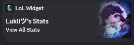
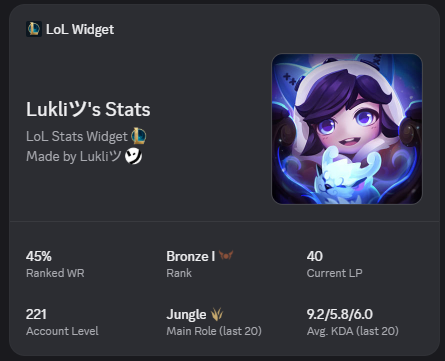

# discord-lol-widget

Shows my League of Legends stats on my Discord profile, using the
(experimental) app profile widget feature. Rank, LP, winrate, average KDA and
main role over the last 20 ranked games, plus the in-game profile icon.

It runs as a small loop: every couple of minutes it asks the Riot API for the
most recent match id (a single cheap request), and only when a new match shows
up does it fetch everything and PATCH the Discord profile. So the widget
updates a few minutes after a game ends instead of on a dumb timer — though
the dumb timer is still available as `update_mode: interval` if you want it.

Heads up: the widget API is an experimental Discord feature and undocumented,
so this whole thing can stop working whenever Discord feels like it.

## Setup

You need:

- Python 3.14+ and [uv](https://docs.astral.sh/uv/) (or Docker / Docker Compose)
- a Riot API key from https://developer.riotgames.com (note: dev keys expire
  after 24h, you'd need a personal/production key for anything long-running)
- a Discord application with the profile widget experiment set up, and its
  bot token.

To get the Discord application, you can follow the [tutorial by Chloe Cinders](https://chloecinders.com/blog/discord-widgets)
and set up the widget as follows:
- Widget Top:
    - Select `Hero` or `Contained` in the Design tab based on personal prefference.
    - In the Content tab, select User Data for both Image and Title.
    - Name the Image field `profile-icon` and the Title field `title`
    - You can add Subtitles with custom strings to your liking.s
- Widget Bottom:
    - Select `Stats Grid` in the Design tab.
    - In the Content section, select User Data for each stat's value.
    - Name the value variables as follows:
        - `winrate-ranked`
        - `rank`
        - `lp`
        - `account-level`
        - `main-role`
        - `avg-kda`
    - Theoretically, you could name them differently, though you would then need to edit the config.
    - More stats are in the making, which later will be added to the config.
    - The Labels can be anything you like by choosing a custom string.
    - For the `rank` and the `main-role` stats you would also need to add User Data for the Icon, naming them `rank-icon` and `main-role-icon` respectively.
- Widget Preview:
    - This can be configured to your liking, but it has to be configured in some way.
- Mini-Profile:
    - If you want to you can add one of the variables from the Widget Top to the Mini-Profile.
    - This is optional and will show up in your Mini-Profile before you go to your whole Profile.

Then:

```
git clone https://github.com/LikeLukli/discord-lol-widget.git
cd discord-lol-widget
uv sync
cp .env.example .env                    # fill in your keys/ids
cp config.example.yaml config.yaml      # fill in your riot id, region etc.
uv run main.py
```

Both real files (`.env`, `config.yaml`) are gitignored.

This is what it could look like after the setup:

Mini Profile:



Normal Widget:



Note: If you want it to constantly update, you'd need to run it either on a Server or on your machine whilst you play.

## Running with Docker

If you'd rather not install Python 3.14 and `uv` on your host or server, you can run the widget in a container with Docker Compose (recommended) or plain Docker.

Make sure you create `.env` and `config.yaml` **before** starting the container (otherwise Docker will create an empty directory instead of mounting `config.yaml`):

```bash
git clone https://github.com/LikeLukli/discord-lol-widget.git
cd discord-lol-widget
cp .env.example .env                    # fill in your keys/ids
cp config.example.yaml config.yaml      # fill in your riot id, region etc.
```

### Docker Compose

Build and start in the background:

```bash
docker compose up -d --build
```

Useful commands:

```bash
docker compose logs -f       # follow logs
docker compose restart       # apply changes to config.yaml
docker compose up -d         # apply changes to .env
docker compose down          # stop and remove the container
```

### Plain Docker

If you prefer using the `docker` CLI directly:

```bash
docker build -t discord-lol-widget .
docker run -d \
  --name discord-lol-widget \
  --restart unless-stopped \
  --init \
  --env-file .env \
  -v "$(pwd)/config.yaml:/app/config.yaml:ro" \
  discord-lol-widget
```

## Running as a Service (Systemd)

If you want to run this automatically on a server or a Raspberry Pi, you can use a systemd service. This is what I use to run the script automatically on my raspberry pi, adjust to your liking:

1. Copy the provided `discord-lol-widget.service` to `/etc/systemd/system/`:
   ```bash
   sudo cp discord-lol-widget.service /etc/systemd/system/
   ```
2. Edit the service file to match your user and paths:
   ```bash
   sudo nano /etc/systemd/system/discord-lol-widget.service
   ```
3. Enable and start the service:
   ```bash
   sudo systemctl daemon-reload
   sudo systemctl enable discord-lol-widget
   sudo systemctl start discord-lol-widget
   ```

Check the logs with:
```bash
journalctl -u discord-lol-widget -f
```

## Config notes

- `riot.game_name` / `riot.tag_line` is your Riot ID (the `Name#TAG` thing).
  Alternatively set `riot.puuid` directly and skip the lookup.
- `riot.platform` is the server (`euw1`, `na1`, ...), `riot.region` the
  routing region (`europe`, `americas`, `asia`).
- `discord_field_names` has to match the field keys you defined in the
  Discord application's widget config, otherwise the values go nowhere.
- `behavior.max_staleness_seconds` forces a refresh every hour even without a
  new match, so stuff like a changed profile icon or dodge LP loss still shows
  up eventually. Set it to 0 to only ever update after matches.

Icons are hotlinked from [CommunityDragon](https://www.communitydragon.org/).

## Credits and Stuff

All rights for the Riot Games API and Assets belong to Riot Games.
All rights for the Discord API and Assets belong to Discord Inc.
Everything else is my own, feel free to use it as you like and modify it as you
see fit.
Contributors are welcome, but I don't have any plans to make this a full-fledged
project with a proper release cycle, so don't expect any guarantees or support.
